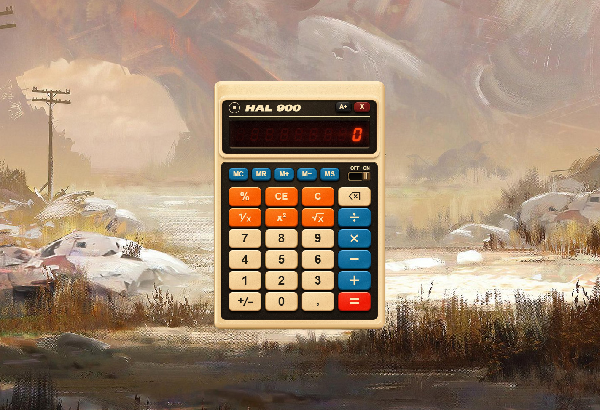

# HAL 900

## Une calculatrice à l'ancienne, pour Windows

HAL 900 est une calculatrice vintage pour Windows, directement inspirée des petites merveilles électroniques des années 1970. Le projet est né d'une idée simple : retrouver le plaisir d'utiliser les objets électroniques d'autrefois, sans renoncer aux fonctionnalités et au confort des outils contemporains.

À une époque, les appareils possédaient une véritable personnalité : des touches mécaniques, des afficheurs lumineux, des boîtiers en plastique coloré et des commandes qu'on prenait plaisir à manipuler. HAL 900 propose de retrouver cette expérience sur un ordinateur moderne, parce qu'une calculatrice n'a aucune raison d'être ennuyeuse !

HAL 900 reprend les fonctionnalités de la calculatrice standard de Windows, mais les habille d'une interface entièrement inspirée des années 1970. Son boîtier ivoire, ses touches colorées, son afficheur rouge et ses effets sonores mécaniques donnent l'impression de manipuler un véritable appareil électronique. Chaque touche s'enfonce, chaque pression produit un petit déclic, et les chiffres s'illuminent sur un afficheur à sept segments.

[Télécharger la dernière version de HAL 900 pour Windows x64](https://github.com/srdrouin/hal900/releases/latest/download/HAL-900-Setup-x64.exe) · [Historique des versions](https://github.com/srdrouin/hal900/releases)

### Fonctionnalités

- Calculs arithmétiques, pourcentages, racines carrées et fonctions mémoire.
- Interface vintage intégralement réalisée en HTML, CSS et JavaScript.
- Animations mécaniques et six effets sonores.
- Afficheur LED à sept segments.
- Compatibilité avec le clavier et le pavé numérique.
- Copier-coller des nombres depuis l'afficheur.
- Deux tailles d'affichage pour s'adapter à votre écran.
- Application légère, autonome et utilisable hors ligne.
- Installateur Windows disponible.

## Une machine avec du caractère

HAL 900 est une calculatrice parfaitement fonctionnelle. Mais, inspirée par son illustre homonyme du cinéma, HAL 9000, elle possède quelques petites particularités.

Demandez-lui une opération impossible ou essayez de l'éteindre avec son interrupteur, et elle vous fera comprendre qu'elle n'est pas tout à fait d'accord… Rassurez-vous : un véritable bouton de fermeture est prévu. HAL 900 n'a pas encore pris le contrôle de votre ordinateur.

## Installation

HAL 900 est compatible avec **Windows 10 et Windows 11 (64 bits)**.

Utilisez l’**installateur Windows** pour installer HAL 900 avec ses raccourcis et son programme de désinstallation.

L'application utilise Microsoft WebView2, présent sur la plupart des ordinateurs Windows récents. L'installateur peut le télécharger si nécessaire. L'application étant distribuée sans certificat commercial de signature de code, Windows SmartScreen peut afficher un avertissement lors de son installation.

## À propos de l'auteur

HAL 900 est une création de [René Drouin](https://www.renedrouin.fr/), auteur, designer graphique et concepteur web.

## Conception et développement

HAL 900 a été conçu et développé avec l'assistance de ChatGPT et Codex, à partir d'une direction artistique originale.

**Technologies** · HTML5, CSS3, JavaScript, Rust et Tauri 2.

Parce qu'un logiciel peut être fonctionnel, ergonomique, léger… et avoir de la gueule !

## Licence et distribution

HAL 900 est un logiciel propriétaire distribué gratuitement (freeware), sans publicité, abonnement ni limitation de durée. Son utilisation est autorisée dans un cadre personnel comme professionnel. Son code source n'est pas distribué publiquement. HAL 900 s'appuie sur plusieurs technologies open source, dont Tauri et Rust, dont les licences respectives sont conservées et respectées.

2026 René Drouin — Tous droits réservés sur les éléments originaux du logiciel.

[Licence de HAL 900](LICENSE.md) · [Licences des composants tiers](THIRD-PARTY-LICENSES.md)
